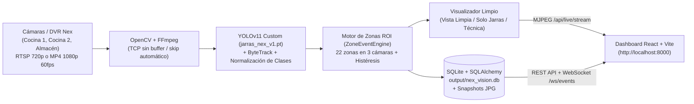

# Resumen Total del Proyecto — Nex Vision AI (`VISIONCOMPUTADORA-ATLAS`)

**Fecha de actualización:** 23 de noviembre de 2026  
**Rama principal de desarrollo:** `RamaNueva` (`https://github.com/Twookinse/VISIONCOMPUTADORA-ATLAS.git`)  
**Última etiqueta publicada en GitHub:** `v0.6` *(con mejoras locales listas para `v0.6.1`)*  

---

## 1. Objetivo del Proyecto

Desarrollar un sistema de **visión por computadora multi-cámara** para la cocina y el almacén del karaoke **Nex (La Paz)** capaz de detectar, rastrear y contabilizar automáticamente el movimiento de jarras, utensilios e insumos sobre zonas específicas (**Zonas ROI**), almacenar cada evento con evidencia fotográfica en una base de datos y presentar métricas operativas en tiempo real a través de un **Dashboard web** accesible desde PC o celular.

---

## 2. Arquitectura y Stack Tecnológico Actual

| Capa | Tecnologías y archivos principales |
| :--- | :--- |
| **Entorno Python** | Python `3.11.9` (`C:\PROYECTOSIA\nex-venv`), `ultralytics 8.4.176`, `opencv-python 5.0.0`, `torch 2.14.1+cpu`, `lap 0.5.13`. |
| **Detección y Tracking** | `src/detection/detector.py`, `src/detection/tracker.py`, `src/detection/visualizer.py`, `config/trackers/bytetrack_cocina.yaml`. |
| **Zonas ROI y Eventos** | `src/events/zones.py`, `src/events/event_engine.py`, `src/analysis/kitchen.py`. |
| **Configuración Multi-Cámara** | `config/cameras.json`, `src/config/cameras.py`, `config/zones/cocina_1.json`, `config/zones/cocina_2.json`, `config/zones/almacen.json`. |
| **Persistencia y Consultas** | `src/db/database.py`, `src/db/models.py`, `src/db/queries.py`, `src/utils/video_meta.py` (SQLite en `output/nex_vision.db`). |
| **Backend API** | FastAPI + Uvicorn (`src/api/main.py`): API REST, Swagger UI (`/docs`), WebSocket (`/ws/events`), subida de videos, streaming MJPEG (`/api/live/stream`), evidencia (`/api/snapshots/{filename}`) y análisis en segundo plano con progreso `%`. |
| **Frontend Dashboard** | React 18 + Vite 6 (`dashboard/src/App.jsx`, `dashboard/src/App.css`), compilado en `dashboard/dist/` y servido directamente por FastAPI. |
| **Lanzador Unificado** | `Iniciar_Nex.bat` (levanta API + BD + Dashboard en un solo proceso en `http://localhost:8000`). |
| **Pruebas y Scripts CLI** | `scripts/draw_zones.py`, `scripts/extract_frames.py`, `scripts/run_detection.py`, `scripts/run_tracking.py`, `scripts/run_counting.py`, `scripts/count_validator.py`, `tests/test_event_engine.py`, `tests/test_api.py`. |

---

## 3. Historia Cronológica por Sprints (Qué se hizo)

### Sprint 0 — Preparación del Entorno (`92fa610`, `b9e2f41`)
- Creación de la estructura base del proyecto, `.gitignore`, `README.md` y repositorio Git.
- Instalación y fijación de dependencias en `C:\PROYECTOSIA\nex-venv` y `requirements.txt`.

### Sprint 1 — Detección y Tracking Básico (`v0.1` · `4f36cd8`)
- Implementación de los wrappers `Detector` y `Tracker` (YOLO + ByteTrack).
- Creación de `src/events/zones.py` y la herramienta interactiva `scripts/draw_zones.py` con coordenadas normalizadas (`0.0` a `1.0`) independientes de la resolución de cámara.
- Creación de `scripts/run_detection.py` y `scripts/run_tracking.py`.

### Sprint 2 — Motor de Eventos y Conteo (`v0.2` · `5fc8cc1` + `549ad15`)
- Configuración de `config/trackers/bytetrack_cocina.yaml` con `track_buffer: 90` para tolerar oclusiones cuando las manos o el cuerpo tapan objetos.
- Desarrollo de `ZoneEventEngine` con histéresis (`min_frames`) para evitar falsos eventos por parpadeo y verificación mediante pruebas unitarias (`tests/test_event_engine.py`).
- Desarrollo de `KitchenAnalyzer` (`src/analysis/kitchen.py`) evaluando el punto central inferior del bounding box (punto de apoyo en la mesa).
- Registro de conteo manual (`tests/ground_truth/conteo_manual.json`) y creación del validador `scripts/count_validator.py`.
- **Línea base obtenida con modelo COCO preentrenado (`yolo26n.pt`):** `0 / 3` jarras detectadas (**0.0% de precisión**), confirmando la necesidad obligatoria de pasar al Sprint 3.

### Sprint 3 — Modelo Custom v1 en Pruebas Caseras (`v0.3` · `99024e5`)
- Creación de `scripts/extract_frames.py` para extraer cuadros de entrenamiento.
- Etiquetado de dataset inicial en **Roboflow** (14 clases de cocina) y entrenamiento en **Google Colab** con `yolo11n.pt` (100 epochs).
- **Resultados obtenidos:** `mAP50 = 96.1%`, `mAP50-95 = 80.8%`, `Precision = 94.4%`, `Recall = 95.3%`.
- **Validación en conteo:** Salto de `0%` a **`100.0%` en levantamientos visibles** (`2 / 2` visibles, `2 / 3` totales incluyendo el levantamiento tapado por el cuerpo), además de contabilizar `Vaso`, `Plato` y `Pinia` desglosados por clase.

### Sprint 4 — Backend FastAPI y Base de Datos SQLite (`v0.4` · `05c8db3`)
- Creación de tablas SQLAlchemy `PipelineRun` y `KitchenEvent` (`src/db/models.py`, `src/db/database.py`).
- Integración automática de `scripts/run_counting.py` con SQLite.
- Creación de la API REST en `src/api/main.py` con `/api/events`, `/api/metrics/hourly`, `/api/runs`, `/api/pipeline/run`, ruta raíz `/` y documentación interactiva Swagger UI (`/docs`).
- Creación y validación de pruebas de integración (`tests/test_api.py`).

### Sprint 5 — Dashboard React, Streaming en Vivo y Lanzador (`v0.5` · `9ae8e7f` y `v0.5.1` · `806360c`)
- Inicialización del proyecto React + Vite en `dashboard/`.
- Implementación de KPIs, gráfico de barras por hora, desglose por objeto, tabla de eventos recientes, filtros (fecha, turno, objeto), estado de cámaras y actualización en vivo por **WebSocket** (`/ws/events`).
- Unificación de Backend + Frontend servido en un solo puerto (`http://localhost:8000`) mediante el lanzador `Iniciar_Nex.bat`.
- Incorporación de:
  - **Subida de videos desde la PC** (`POST /api/videos/upload`) para analizar grabaciones pasadas en un clic.
  - **Monitoreo en vivo y reproducción con marcas** (`/api/live/*`) optimizado para cámaras RTSP `720p @ 1000 KB/s` (`rtsp_transport;tcp|fflags;nobuffer` y `CAP_PROP_BUFFERSIZE = 1`).
  - Rediseño visual final adoptando la estética clara, técnica y limpia estilo FastAPI / Swagger UI.

### Sprint 6 — Migración Real a las 3 Cámaras de Nex (`v0.6` · `d8ce601`)
- Incorporación de los **5 videos reales del karaoke Nex** (`1920x1080 @ 60 FPS`, 8 a 10 min cada uno): `COCINA 1 VIDEO 1.mp4`, `COCINA 2 VIDEO 1..3.mp4` y `ALMACEN VIDEO 1.mp4`.
- Extracción y depuración de **263 frames limpios** para etiquetado colaborativo en equipo en **Roboflow**, expandidos con augmentations a **~900 imágenes**.
- Entrenamiento en Google Colab del modelo oficial de Nex (`models/custom/jarras_nex_v1.pt`, 100 epochs, 38 clases): **`mAP50 = 68.4%`** (superando el umbral mínimo de `60%`).
- Trazado manual de **22 Zonas ROI reales** en las 3 cámaras:
  - `config/zones/cocina_1.json` (**7 zonas**: `Mesa de Centro`, `Congelador`, `Mesa de Electrodomesticos`, `Zona de Lavado`, `Mesa de Apoyo`, `Mesa de apoyo2`, `Mesa de apoyo3`).
  - `config/zones/cocina_2.json` (**9 zonas**: `Mesa de Centro`, `Congelador`, `Zona de Lavado`, `Mesa de apoyo`, `Mesa de electrodomesticos`, `Mueble para objetos`, `Mesa de apoyo2`, `Mesa de apoyo3`, `Zona de tostar/hervir`).
  - `config/zones/almacen.json` (**6 zonas**: `Estante de productos alimenticios`, `Estante de productos culinarios`, `Estante de objetos culinarios2`, `Refrigerador`, `Refrigerador2`, `Zona de lavado`).
- Configuración multi-cámara centralizada en `config/cameras.json` + `src/config/cameras.py` (pensada para desplegar en Nex ingresando únicamente los enlaces `rtsp_url` sin tocar código).
- Actualización del Dashboard con pestañas por cámara (`Todas`, `Cocina 1`, `Cocina 2`, `Almacén`), cambio rápido de cámara en vivo, guardado de RTSP desde la interfaz y análisis en segundo plano con barra de progreso `%`.
- **Prueba piloto real (45s por cámara):** Detección limpia de `Jarra #5` en `COCINA 1` (`Mesa de Centro`) con 0 falsos positivos de personas o electrodomésticos fijos.

### Mejoras Posteriores a `v0.6` *(Implementadas localmente, pendientes de commit `v0.6.1`)*
1. **Visualizador Limpio (`src/detection/visualizer.py`):**
   - Controles en caliente sobre el reproductor sin reiniciar la transmisión: **`Vista Limpia`** (por defecto), **`Solo Jarras`**, **`Vista Técnica`** y toggle **`Zonas ROI: SI/NO`**.
   - Elimina la saturación de cajas ocultando objetos fijos/personas, marcando utensilios quietos con un punto sutil en su base y resaltando en rojo/verde brillante durante 3 segundos cualquier objeto que dispara un evento.
2. **Fotos de Evidencia (*Snapshots*) por Evento:**
   - Guardado automático en `output/snapshots/` del instante exacto de cada salida o entrada resaltando únicamente el objeto y la zona involucrada.
   - Columna **`Evidencia` → `Ver Foto`** en el Dashboard con visor modal para auditar eventos al instante.
3. **Jornadas Nocturnas y Metadatos de Video (`src/db/queries.py` y `src/utils/video_meta.py`):**
   - Lógica de **jornada nocturna** para karaoke (`08:00` a `07:59` del día siguiente) para que el turno noche (`21:00 - 04:59`) quede agrupado en una misma jornada y separación de modos de conteo vs. demo.
   - Resolución de la **hora real de grabación** (desde parámetro manual o nombre del archivo del DVR) y huella rápida SHA-1 (`compute_source_key`) para identificar si un mismo archivo de video se vuelve a analizar.

---

## 4. Problemas Encontrados en el Camino y Cómo se Resolvieron

| # | Problema ocurrido | Causa raíz | Solución aplicada |
| :-: | :--- | :--- | :--- |
| 1 | Pérdida aparente del historial de chat tras actualizar Antigravity | La nueva versión cambió la ruta de almacenamiento de `antigravity-ide/brain` a `antigravity-cli/brain` | Se auditó el repositorio completo, entorno `nex-venv` y `docs/Sprints.txt`, retomando exactamente desde el Sprint 2.7 sin pérdida de código. |
| 2 | Precisión de `0%` en conteo inicial | El modelo COCO preentrenado (`yolo26n.pt`) no contenía la clase `Jarra` | Se entrenó un modelo YOLOv11 custom en Colab con imágenes reales (primero caseras y luego de Nex). |
| 3 | Error `GET / HTTP/1.1 404 Not Found` al abrir `localhost:8000` | Solo existían rutas `/api/*` y `/docs` | Se agregó la ruta raíz `/` que sirve el Dashboard React compilado o el estado de la API. |
| 4 | "Reproducir con Marcas" no mostraba video | Dos causas combinadas: (a) `models/custom/jarras_nex_v1.pt` sufrió conversión binaria `LF→CRLF` inflándose de `5.5 MB` a `9.8 MB`; (b) `Date.now()` en el render de React reiniciaba el `` MJPEG cada 5 segundos | Se restauró el `.pt` original, se fijó `streamKey` en estado de React, se pasó `/api/live/stream` a generador `async` y se añadió vista previa instantánea del primer cuadro. |
| 5 | Ventana de `draw_zones.py` cortada ("con zoom") y logo de grabación al inicio | Los videos de Nex eran `1920x1080 @ 60 FPS` (superando el monitor en `WINDOW_AUTOSIZE`) y el frame `0` mostraba el ícono del grabador DVR (presente también en 12 frames extraídos) | Se cambió a `WINDOW_NORMAL` (`1280x720`), se arrancó por defecto en frame `300`, se añadieron teclas `N`/`B` (±2s) y se depuraron los 12 frames con logo de `output/frames/`. |
| 6 | 38 clases numeradas y duplicadas tras etiquetar en equipo (`Jarra1..5`, `Taper2..5`, `Persona1..6`, `Microondas`) | Varios etiquetadores crearon variantes numeradas e incluyeron elementos fijos | Se implementó `normalize_class_name()` e `IGNORED_CLASSES` en `src/analysis/kitchen.py`, unificando nombres limpios y descartando personas/equipos fijos del conteo. |
| 7 | Video saturado visualmente con ~20 cajas amontonadas | `results.plot()` dibujaba todas las detecciones y confianzas encima de polígonos rellenos | Se creó `src/detection/visualizer.py` con **Vista Limpia**, **Solo Jarras**, **Vista Técnica**, toggle de zonas y fotos **Snapshot** por evento. |
| 8 | Falsos cruces en objetos apoyados en el borde exacto de una zona | Al auditar el primer snapshot (`cocina_1_Jarra_id5_f1770_salida.jpg`), se observó una jarra apoyada a 2-3 px del borde inferior de `Mesa de Centro` | El visor **`Ver Foto`** permite identificar de inmediato bordes muy ajustados para darles un pequeño margen en `config/zones/*.json`. |

---

## 5. Historial de Versiones en GitHub (`RamaNueva`)

| Tag | Commit | Descripción |
| :---: | :---: | :--- |
| `v0.1` | `4f36cd8` | Detección y tracking funcionando + herramienta de zonas ROI |
| `v0.2` | `5fc8cc1` | Motor de eventos y conteo de jarras |
| `v0.3` | `99024e5` | Modelo custom v1 y conteo multiclase (+ validador `549ad15`) |
| `v0.4` | `05c8db3` | Backend FastAPI y base de datos SQLite |
| `v0.5` | `9ae8e7f` | Dashboard React y WebSocket en vivo |
| `v0.5.1` | `806360c` | Lanzador unificado, estética estilo API y zonas reales de Nex |
| `v0.6` | `d8ce601` | Soporte multi-cámara Nex (`Cocina 1`, `Cocina 2`, `Almacén`) y prueba piloto |
| *(Pendiente)* | *Local* | `v0.6.1`: Vista Limpia, Snapshots de evidencia, jornadas nocturnas y metadatos de video |

---

## 6. Qué Falta para el Cierre Final (Sprint 7 — Despliegue en el Local)

1. **Subir a GitHub (`v0.6.1`):** Confirmar y respaldar las mejoras locales actuales (`visualizer.py`, snapshots, `queries.py`, `video_meta.py` y ajustes del Dashboard).
2. **Lanzador tipo App de Escritorio silencioso:** Reemplazar la ventana visible de consola de `Iniciar_Nex.bat` por un lanzador silencioso (`.vbs` / acceso directo con ícono) que abra el Dashboard en modo aplicación (`--app=http://localhost:8000`) similar a un sistema de ventas nativo.
3. **Empaquetado Docker (opcional según el equipo de Nex):** Crear `Dockerfile` y `docker-compose.yml` con auto-arranque (`restart: always`).
4. **Instalación presencial en Nex:**
   - Conectar la PC a la red local del DVR/NVR de Nex.
   - Ingresar los 3 enlaces `rtsp://usuario:clave@IP:554/...` desde el Dashboard (**Guardar RTSP**) o directamente en `config/cameras.json`.
   - Dar un pequeño margen a los bordes de zonas si las fotos de evidencia muestran objetos descansando muy cerca de la línea (ej. borde inferior de `Mesa de Centro` en `Cocina 1`).
   - Ejecutar el período de prueba en operación real (1–2 semanas).
